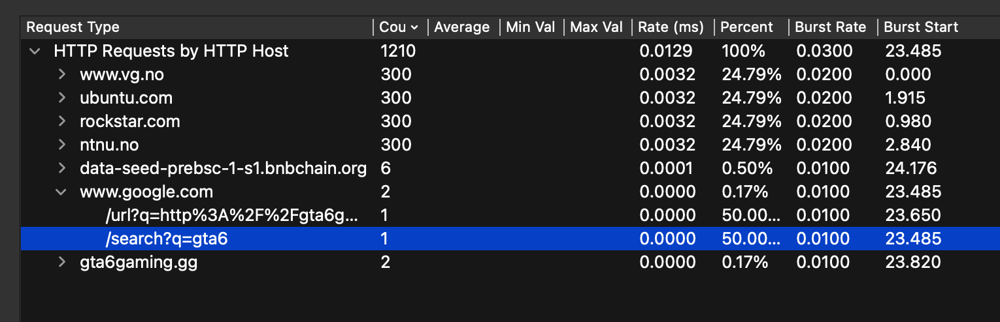

# EtherHiding 1
By Frikk Brændsrød

### Desc
What did the user search for before visiting the gaming site?

### Files included
challenge.pcap

### Solve
The included file has over 16 000 packets which makes it fun to search through...
At the beginning i tried to search through it by using "frame contains xxx". This proved early to be difficult minding the amount of packets. Wireshark has a feature called statistics which has a http function. The http requests statistics shows that the pcap included packets from 7 different domains. After looking through these i found a google query, **/search?q=gta6** this was the flag i was searching for.

## Flag
CTFkom{gta6}