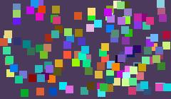
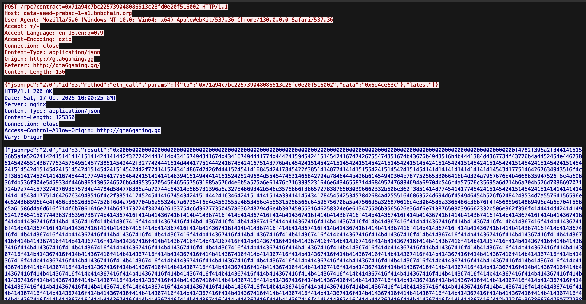
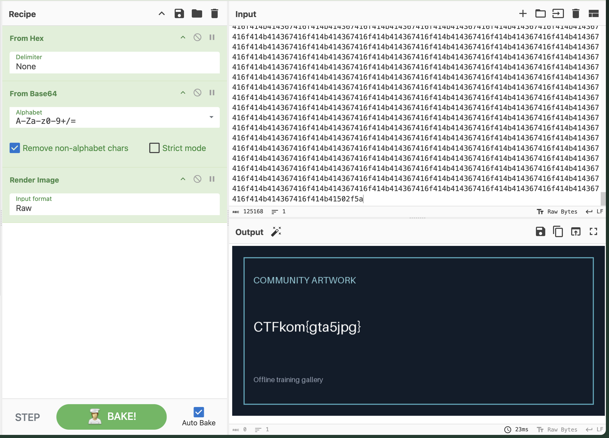

# EtherHiding 4
By Frikk Brændsrød

### Desc
Recover the final artwork and find its secret. submit the complete flag shown in the image


### Files included
challenge.pcap

### Solve
This challenge continued on the trace from EtherHiding 3. But to begin with i tried to extract images that was requested over http. Wireshark has a feature to export images. **File -> Export objects -> HTTP -> Content type = Image/JPEG** and then download all. This had me confused and stuck a while since all i got was 400 images of rainbow coloured dots... <br>


After a while i went away from the dots and started manually searching throught the requests that were made. This landed me with the search **frame contains "artwork"** which again lead me to a javascript file that loads the artwork im searching for through **async function loadArtwork()**. 

Through reading the JS i found a hex that was hardcoded and related to the prevoius task 
```const first = await rpc(endpoint, "eth_call",
    [{to: firstContract, data: "0x6d4ce63c"}, "latest"]);
```
**frame contains "0x6d4ce63c"**


The hex included 
Pasting the stripped hex into cyberchef and applying **From hex**, **From base64**, **Render image** gives the complete image including the flag.


## Flag
CTFkom{gta5jpg}