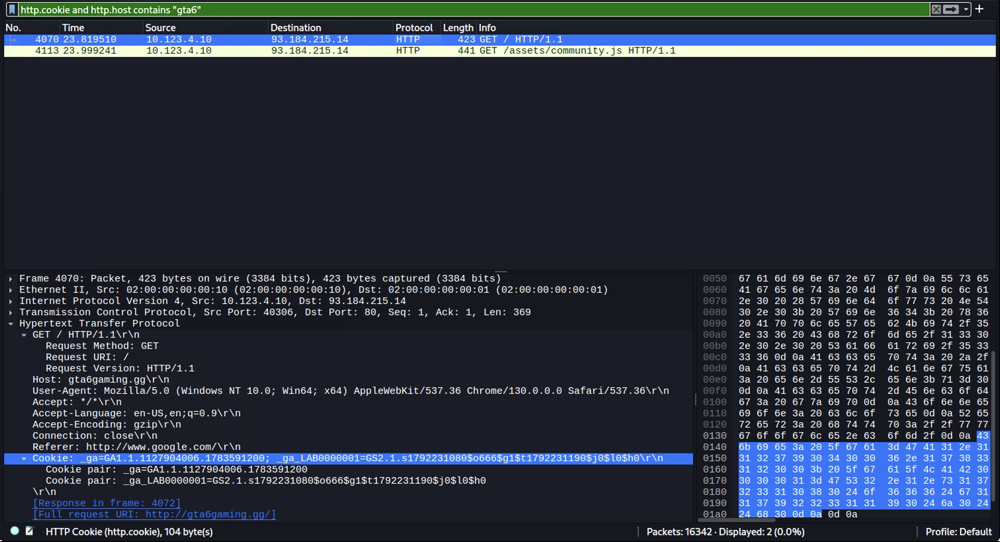

**Task Description:**

**Solution Steps:**
1. Opened the challenge pcap and filtered for `http.cookie` to find HTTP requests containing cookies. 
2. There is requests to multiple URLs, so we have to narrow it down further. From Statistics -> HTTP -> Requests, we can see the requested domains and URLs. `gta6gaming.gg` seems like an interesting choice for further investigation. 
3. 
